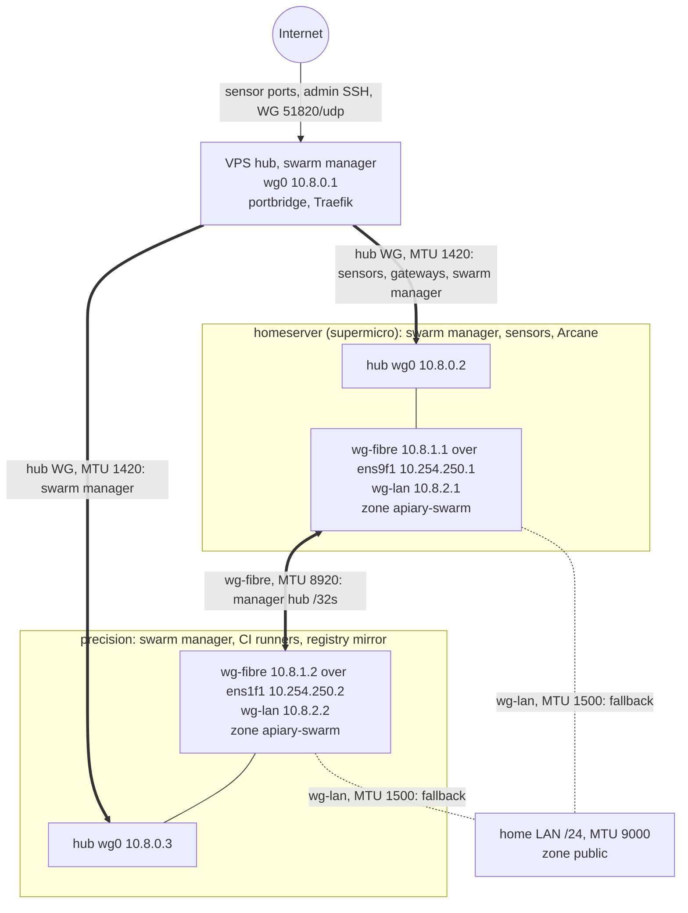

# Swarm network: tunnels, addressing and the swarm-plane firewall

[← back to README](../README.md) · [Network](NETWORK.md) · [CGNAT deployment](CGNAT-DEPLOYMENT.md) · [Architecture](ARCHITECTURE.md)

This document owns the network decisions for the three-node Docker Swarm
(epic [#3587](https://github.com/Xore/APIARY/issues/3587)): which tunnels exist,
how they are addressed, which flows cross them, and how the firewall is applied
and rolled back. [NETWORK.md](NETWORK.md) still owns the ingress paths, source
attribution and per-sensor isolation. Those do not change here.

**Status (2026-10-10).**
- **Phase 0 ([#3588](https://github.com/Xore/APIARY/issues/3588))** is live on homeserver and precision. The direct fibre is in its own default-deny `apiary-swarm` zone, and the swarm plane is closed on every LAN and public interface.
- **Phase 1 ([#3589](https://github.com/Xore/APIARY/issues/3589))** is live on all three nodes. The VPS hub carries precision as a second spoke (`10.8.0.3`). homeserver ↔ precision run WireGuard over the fibre (`wg-fibre`), with an automatic LAN fallback (`wg-lan`). The swarm was re-initialised on the hub addresses and node labels are set. Every WireGuard interface is in `apiary-swarm`. Host state, rollout and runbooks are in [ops/swarm](../ops/swarm/README.md).
- **Three managers (since 2026-10-23, [#3712](https://github.com/Xore-Inc/APIARY/issues/3712)).** After the #3708 `/var` loss cost the two-manager swarm its quorum, Xore decided on 2026-10-19 to promote the VPS. homeserver, precision and the VPS are all managers on their hub addresses; the VPS opens TCP 2377 to the two peers on `wg0` only. See [Manager quorum](#manager-quorum).

The per-service, per-port evidence behind the flow matrix is the
[#3588 live/repo port inventory](https://github.com/Xore/APIARY/issues/3588#issuecomment-6098046203),
taken on 2026-10-10. Check live state again before changing a host.

## Topology

The explorable diagram is [`diagrams/swarm-network-topology.html`](diagrams/swarm-network-topology.html).
All edges carry traffic today (phase 1). The dotted edge is the LAN fallback, used only while the fibre tunnel fails.



## Decisions

These are decided (Xore, 2026-10-10). They are not options. A change needs a new
decision on #3587.

1. **Hub-and-spoke on the VPS.** The VPS runs the WireGuard hub. homeserver and precision are spokes; there is no full mesh through the Internet. The VPS is already the only Internet-facing host ([NETWORK.md](NETWORK.md)), so it also terminates the only Internet tunnels.
2. **homeserver ↔ precision runs WireGuard over the raw fibre.** The direct 10 Gb link (`ens9f1` ↔ `ens1f1`) carries a dedicated WireGuard tunnel. The swarm does not rely on IPsec of encrypted overlays alone: VXLAN of unencrypted overlays, gossip and the manager API are plaintext.
3. **MTU 9000 on the LAN and the fibre. Everything else keeps the WireGuard default** (about 1420 on the Internet hub path). See the MTU budget below.
4. **Addressing.**
   - Hub `10.8.0.0/24`: VPS `.1`, homeserver `.2`, precision `.3` (new).
   - Fibre WireGuard `10.8.1.0/30`: homeserver `.1`, precision `.2`, over the existing `10.254.250.0/30` underlay.
5. **Every swarm node re-joins on its hub address.** `--advertise-addr` and `--data-path-addr` become the node's `10.8.0.x`, so the VPS can reach every node. homeserver ↔ precision hub traffic routes over the fibre tunnel (a host route for the peer's `10.8.0.x` via `10.8.1.x`), never through the VPS.
6. **Fibre-down fallback is a second WireGuard tunnel over the LAN** (WireGuard interface MTU 1500). It takes over automatically, using a health-probed route-metric switch from the fibre tunnel to the LAN tunnel, and it hands back when the fibre recovers. Failover and recovery are tested in #3589 before anything relies on them.
7. **Keys are host-generated and never stored in git.** Each host creates its own private key (`wg genkey`, mode 0600, under `/etc/wireguard/`). Only public keys and endpoints are templated into the repo. Rotation is the manual runbook below, run on suspicion of compromise or yearly.
8. **The flow matrix below is the firewall.** It is derived from the inventory and is default deny in both directions on every tunnel interface. It is applied with the dead-man rollback and the probes in this document, with no further design review gate.

## Addressing and MTU budget

| Link | Underlay | WireGuard interface | Addresses | Interface MTU |
|---|---|---|---|---|
| VPS hub | public Internet, UDP 51820 | `wg0` on each host | `10.8.0.1` / `.2` / `.3` | 1420 (default) |
| Fibre | `10.254.250.0/30`, MTU 9000, UDP 51821 | `wg-fibre` | `10.8.1.1` / `10.8.1.2` | 8920 (9000 − 80) |
| LAN fallback | home LAN `/24`, MTU 9000, UDP 51822 | `wg-lan` | `10.8.2.1` / `10.8.2.2` | 1500 |
| Swarm | the tunnels above | NodeAddr and data path = hub address | `10.8.0.1` / `.2` / `.3`, all managers | overlay ingress 1310 |

Routing: each manager holds a host route for the other manager's hub `/32` (`10.8.0.3` on homeserver, `10.8.0.2` on precision), kept on `wg-fibre` by `peer-route.service`. It moves to `wg-lan` after two failed fibre probes, and back after three good ones. The hub `wg0` peers carry only `10.8.0.1/32` on the spokes, so manager-to-manager traffic can never detour through the VPS.

The largest overlay MTU on a path is the WireGuard interface MTU, minus 50 for
VXLAN, minus up to 60 for ESP on `--opt encrypted` overlays. The numbers below are
derived. On 2026-10-10 #3589 verified the WireGuard interface MTUs with `ping -M do -s <MTU − 28>` (passes) and `<MTU − 27>` (`Message too long`) on `wg-fibre` (8920), `wg-lan` (1500) and hub `wg0` (1420). Encrypted test overlays carried traffic at 1390 (managers) and 1310 (including the VPS).

| Overlay spans | Largest overlay MTU |
|---|---|
| fibre only, and need not survive failover | 8810 |
| homeserver ↔ precision, must survive fibre failover | 1390 (LAN fallback path) |
| any path through the VPS hub | 1310 |

An overlay must be sized for the smallest path it can ever take, including the
fallback path. Otherwise a fibre failure turns into a PMTU black hole, not a
failover. ICMP stays open in the swarm zone so PMTU discovery keeps working.

## Flow matrix

Interfaces:
- `F` is the direct fibre (`ens9f1` on homeserver, `ens1f1` on precision; `enp4s0f1` in records before 2026-10-31).
- `H` is the VPS ↔ homeserver `wg0`.
- `L` is the LAN/uplink (`ens9f0` and `eno1` on homeserver, `ens1f0` on precision).

Inbound swarm rules are bound to the interfaces in `apiary-swarm` (the fibre, `wg0`, `wg-fibre` and `wg-lan`), restricted to the peer sources in each host's env file, and default deny with rate-limited logging. The peer-scoped SSH rule carries the Arcane tunnel and admin SSH; on the VPS it is TCP 2222, because port 22 there is the cowrie honeypot. `public` logs and drops the swarm protocols on the LAN/uplink and on the VPS `eth0`. Ordinary egress and the existing unrelated publications are unchanged.

| Source → destination | Interface; protocol/port | Purpose | Owner / phase |
|---|---|---|---|
| precision `10.254.250.2` → homeserver `10.254.250.1` | F; TCP 2377, TCP/UDP 7946, UDP 4789, ESP (IP protocol 50) | Manager control, gossip, VXLAN, encrypted overlay | #3588 / live |
| homeserver `10.254.250.1` → precision `10.254.250.2` | F; TCP 2377, TCP/UDP 7946, UDP 4789, ESP | Manager control (precision is a manager since #3589), gossip and overlay | #3588 / live |
| precision → homeserver | F; TCP 22, then loopback TCP 13552 → H TCP 3552 | `arcane-fibre-tunnel` user-level SSH forward to the Arcane manager; the agent listens on loopback TCP 3553. Phase 1 keeps the forward but routes its SSH connection over the manager hub address. | #3588 / live; #3589 route change |
| homeserver ↔ precision | F and L; ICMP | PMTU discovery and health probes | #3588 / live |
| LAN admin → homeserver/precision | L; TCP 22 | Existing SSH access, kept in `public` | ops / existing |
| VPS portbridge → homeserver sensors | H; exact TCP/UDP mappings in the [inventory](https://github.com/Xore/APIARY/issues/3588#issuecomment-6098046203), including translated ports | Internet honeypot traffic; attacker `source.ip` preserved | #3573 / existing |
| VPS Traefik/socat → homeserver gateways | H; the dashboard, Arcane, Keycloak, Kibana and other published ports in the inventory | OIDC-gated tools; no new host openings | #3579 / existing |
| CI runners → precision registry mirror | local Docker bridge; TCP 5555 → 5000 | Image pulls; not LAN-published | CI / existing |
| VPS ↔ homeserver/precision (all managers) | H; WireGuard UDP 51820 underlay, then peer-scoped TCP 2377 **both ways**, TCP/UDP 7946, UDP 4789, ESP | Raft among three managers, gossip and encrypted overlays. The VPS accepts 2377 from `10.8.0.2/32` and `10.8.0.3/32` on `wg0` only | #3589 / live; VPS 2377 since 2026-10-19 (#3712) |
| homeserver ↔ precision | fibre WG `10.8.1.0/30` over fibre UDP 51821; LAN fallback WG `10.8.2.0/30` over peer-scoped LAN UDP 51822; peer-scoped swarm ports above | Direct encrypted swarm path and failover. The only `public` addition is a peer-scoped accept for UDP 51822 | #3589 / live |
| precision → homeserver | `wg-fibre`/`wg-lan`; TCP 22 to `10.8.0.2` | `arcane-fibre-tunnel` (`authorized_keys` `from="10.254.250.2,10.8.0.3"`, forward to `10.8.0.2:3552` only) | #3589 / live |
| homeserver → VPS | H; TCP 2222 | Existing homeserver-initiated SSH to the VPS | existing; peer-scoped in #3589 |
| VPS → homeserver Docker-published ports | H; `DOCKER-USER` chain `APIARY-WG-IN`: NEW flows from `10.8.0.1` to `10.8.0.2` on the [77-port list](../ops/firewall/hosts/homeserver-wg-ports.txt) only, all else dropped | Sensors and gateways; blocks wildcard publications (pentagi 28012-28013) on the hub | #3589 / live |
| BFF/backend overlay | rides the overlay (VXLAN/ESP above) | Encrypted BFF overlay; no extra host ports | #3579 |

What the swarm-plane firewall does *not* cover:
- **Docker-published ports.** Do not infer that a firewalld `INPUT` rule protects a Docker-published port: DNAT sends that traffic through `FORWARD`/`DOCKER-USER`. Swarm listeners and kernel VXLAN/ESP use `INPUT`, so `swarm-plane.sh` changes no `DOCKER-USER` rule. Since #3589, the separate [`home-wg-forward`](../ops/firewall/home-wg-forward.sh) policy covers Docker-published ports reached over homeserver `wg0`. Ports published on the LAN are still unprotected (#3604).
- **Host-mode sensor publication.** A swarm `mode: host` port binds every address. [`home-swarm-host-guard.sh`](../ops/firewall/home-swarm-host-guard.sh) (#3593) drops NEW flows to the listed sensor ports in `DOCKER-USER` unless they arrive from the VPS on `wg0` to `10.8.0.2`; see the [ops/swarm runbook](../ops/swarm/README.md#sensor-and-edge-stacks-what-replaces-per-service-hardening-3593-3595).
- **Forwarding.** Preserve portbridge forwarding and source attribution in both follow-ups.

The rules are code: [`ops/firewall/swarm-plane.sh`](../ops/firewall/swarm-plane.sh) with one env file per host in [`ops/firewall/hosts/`](../ops/firewall/hosts/). `apply` converges idempotently. Rules the script owns (the shapes it emits) that are no longer in the env file are removed; any other rule in the zone is kept and reported as unmanaged (#3712). `hosts/vps.env` was not applied in phase 0; since phase 1 every host's env is applied, and all three set `SWARM_MANAGER=1`.

### Why a dedicated zone, not source-scoped rules in `public`

firewalld rich rules cannot match an input interface. The 2026-10-09 rules
accepted 2377/7946/4789 "from 10.254.250.x" in `public`, which also matched a
spoofed packet arriving on the LAN uplink. precision's uplink runs loose
`rp_filter` (multihome, `/etc/sysctl.d/90-apiary-multihome.conf`), so a LAN host
that routed `10.254.250.2` via precision's uplink and spoofed `10.254.250.1` got
a SYN-ACK from 7946. Binding the fibre interface into its own zone makes the
interface the first match. The same probe then got no SYN-ACK and logged
`apiary-swarm-lan:` on precision's uplink. homeserver's uplink runs strict `rp_filter`, so
the kernel drops the spoof there before firewalld logs it. (On 2026-10-31
precision's uplink is `ens1f0` and runs strict `rp_filter` too: the multihome
sysctl file is not installed since its reinstall, and `eno1` stays disabled.)

## LAN service ports: decision pending

These listeners are reachable on a LAN interface today and are outside the
swarm plane. Phase 0 leaves them unchanged. Whether each moves to WireGuard-only,
moves to loopback, stays on the LAN or closes is decided in
[#3604](https://github.com/Xore/APIARY/issues/3604), not here.

| Host | Listener | Service | Why it is open | Decision |
|---|---|---|---|---|
| homeserver | `ens9f0` LAN address, TCP 8888 and 8899 | Unsloth Studio (can run arbitrary code) | live `UNSLOTH_BIND` resolves to the LAN address; repo default is `10.8.0.2` | pending, #3604 |
| homeserver | `ens9f0` LAN address, TCP/UDP 53, TCP 5380 and 53443 | Technitium DNS, admin UI, DoH | live `LAN_IP` binding set outside `.env`; repo default is loopback | pending, #3604 |
| homeserver | `0.0.0.0:28012-28013` TCP | `pentagi-terminal-6` docker-proxy | not from any Compose project; DNAT can bypass `INPUT` | pending, #3604 |
| homeserver | `0.0.0.0:3020` TCP | bun `serve.ts` as user xore | allowed in `public` (every LAN interface and `wg0`) | pending, #3604 |
| homeserver | `0.0.0.0:44321`, `4330`, `5666`, `5999`, `7777` TCP | pmcd, pmlogger, SuperDoctor5 | wildcard binds; no zone allows them | pending, #3604 |
| precision | `0.0.0.0:9090` TCP | Cockpit | `public` allows the cockpit service on the uplink | pending, #3604 |
| homeserver, precision | `0.0.0.0:22` TCP | sshd | admin path | kept (ops), revisited in #3604 |
| VPS | portbridge `tcp:8543` | sonicwall honeypot | in the repo RULES, missing from live RULES (drift) | pending, #3604 |

## Failure modes

| Failure | Phase 1, two managers (2026-10-10 to 10-19) | Now: three managers (since 2026-10-23) |
|---|---|---|
| **VPS down** | No Internet traffic reaches the sensors (portbridge is on the VPS), so capture pauses because there is nothing to capture. The public dashboards and OIDC gateways are offline. Both managers keep quorum over the fibre tunnel. | The same for ingress and gateways. homeserver and precision are two of three managers, so quorum holds and the swarm between them is unaffected. |
| **Fibre down** | The LAN WireGuard tunnel takes over automatically. Overlay traffic continues at the fallback MTU, which is why failover-surviving overlays are sized for 1390. When the fibre recovers, the route switches back. **Tested 2026-10-10:** all fibre traffic dropped for 40 s, 2.7 s gap, no Raft election, Arcane stayed online, no loss on recovery. | The same. |
| **Fibre and LAN down** | The two managers lose quorum: their hub traffic never routes through the VPS (decision 5). Running tasks continue, but scheduling and updates stop. | homeserver and precision cannot reach each other, but each still reaches the VPS, so a leader plus the VPS is a majority. Overlay traffic between homeserver and precision stops, and the cut-off manager may cause leader churn until the path returns. Not tested. |
| **homeserver down** | The two-manager quorum is lost (this happened in #3708). Sensors are down. | precision and the VPS keep quorum. Sensors are down. Services pinned to the homeserver cannot move. |
| **precision down** | The two-manager quorum is lost. CI runners and the registry mirror are offline. | homeserver and the VPS keep quorum. CI runners and the registry mirror are offline. Services constrained to `node.labels.sensor == false` have nowhere to go (the homeserver is excluded by that label and the VPS by `role=worker`), so they stay pending until precision returns, by design: no generic workload on the sensor or edge host. Services with `apiary.homeserver: allow` (canary, Galah broker) move to the homeserver. |
| **Two managers down** | n/a | Quorum is lost. Running tasks continue; nothing can be listed, scheduled or changed. Recover from the survivor: [HOMESERVER-VAR-RECOVERY.md part 12](HOMESERVER-VAR-RECOVERY.md#12-swarm-quorum-recovery), scripted by `swarm-membership.sh restore-quorum`. |
| **Rollback timer fires** | The firewall config from before the change is restored. SSH and established flows survive through conntrack. See Rollback. | The same. |

### Manager quorum

Decided by Xore on 2026-10-19 ([#3589](https://github.com/Xore-Inc/APIARY/issues/3589#issuecomment-6256193293)), superseding the two-manager decision of 2026-10-10 ([#3587](https://github.com/Xore-Inc/APIARY/issues/3587#issuecomment-6091107601)): **three managers, homeserver, precision and the VPS.** The cluster survives losing any one host. Accepted trade-off: the internet-facing VPS holds the full raft store (every swarm secret and config, the cluster CA and the join tokens), so a root compromise of the VPS is a compromise of the swarm control plane. Mitigations: plane-only addresses (`10.8.0.1` for advertise, listen and data path), TCP 2377 accepted only from the two peers on `wg0` and logged-dropped on `eth0`, and the label `role=worker`, which keeps `node.labels.role == manager` placements off the edge host. Autolock is off (open decision). The `peer-route` failover keeps a fibre cut below the roughly 10 s Raft election timeout. Lost quorum: [ops/swarm runbook](../ops/swarm/README.md#runbook-lost-quorum) and [HOMESERVER-VAR-RECOVERY.md part 12](HOMESERVER-VAR-RECOVERY.md#12-swarm-quorum-recovery). Node maintenance: [ops/swarm runbook](../ops/swarm/README.md#runbook-node-maintenance-drain--work--active).

## Key handling and rotation

Private keys never leave the host that generated them and never enter git,
issues or logs. The repo holds only templates, public keys and endpoints.

Per-tunnel specifics (hub spokes, the fibre and LAN tunnels, the Arcane tunnel key) are in the [ops/swarm runbook](../ops/swarm/README.md#runbook-key-rotation).

Rotation runbook (on suspected compromise, or yearly), one tunnel and one peer at a time:
1. Confirm a second path to the host (another tunnel, the LAN or the console) before touching its keys.
2. On the host, generate a new key pair (`umask 077; wg genkey | tee new.key | wg pubkey > new.pub`).
3. Add the new public key to the peer, alongside the old one where the tool allows it. Otherwise schedule the swap inside a dead-man window.
4. Switch the host to the new private key with `wg set <iface> private-key new.key` and update the config file.
5. Verify the handshake (`wg show`), the probes and swarm `Ready`.
6. Remove the old public key from the peer and delete the old private key.
7. Record the date (not the key) on the tracking issue.

On suspected compromise, remove the old peer key first and accept the short outage. Do not wait for the overlap.

## Apply, probe and rollback

This section is the phase 0 procedure for the fibre zone. The phase 1 rollout (WireGuard, membership, the hub `DOCKER-USER` policy and the VPS) and its dead-man timers are in [ops/swarm](../ops/swarm/README.md#how-it-was-applied-and-how-to-re-apply).

Apply **precision first, then homeserver**, one host at a time, from a checkout
of the merged repo on each host. Before touching rules, confirm current interface
zones, swarm node state, the SSH path, sensor ingest and timer state. Do not
apply `hosts/vps.env` in phase 0. Never run concurrent firewalld changes during a
rollback window.

```bash
sudo -n firewall-cmd --get-active-zones
sudo -n systemctl list-timers --all 'fw-rollback-3588*'
ssh homeserver 'sudo -n docker node ls'  # both nodes must be Ready
cd ops/firewall
backup=$(sudo -n ./swarm-plane.sh backup hosts/HOST.env)
sudo -n ./swarm-plane.sh arm "$backup" 10min
sudo -n ./swarm-plane.sh apply hosts/HOST.env
sudo -n ./swarm-plane.sh status hosts/HOST.env
```

Use `precision.env` or `homeserver.env` for `HOST.env`. Verify the timer is
**active and scheduled** before `apply`. Then prove both sides:

- **Outside** (from a separate LAN workstation session):
  - reconnect with `ssh precision` or `ssh homeserver`;
  - scan the LAN addresses with `nmap -Pn -sT -sU -p T:2377,7946,U:7946,4789`: TCP must be `filtered`, UDP `open|filtered`;
  - spoof test: add a host route for the fibre address via the host's uplink and send SYNs with the fibre peer as source, from a fixed source port (`nping --tcp -p 7946 -g <port> --flags syn -S <peer> <fibre-addr>`). Capture on the host with `tcpdump -ni any "tcp port <port>"`. There must be **no SYN-ACK** on any interface. Remove the route afterwards.
- **Inside** (from the fibre peer):
  - TCP 2377/7946 open, both nodes `Ready`;
  - restart `arcane-fibre-tunnel` so the SSH forward reconnects under the new rules;
  - encrypted overlay test: on an attachable `--opt encrypted` test overlay, ping both ways. `ip xfrm state` must be nonempty and `tcpdump -ni <fibre> esp` must show ESP both directions. A paused manager cannot attach containers (#3722); supermicro is `Active` since then.
- **Services:**
  - Arcane: precision's environment `online`, its containers listed through the manager API, and a GitOps sync returning success. A local socket or active unit alone is not proof.
  - Runners: online.
  - Ingest: the `honeypot-v2*` doc count rising over a minute, with recent events carrying a public attacker `source.ip`.

Only after the outside and inside proofs both pass, stop that host's timer with
`sudo -n ./swarm-plane.sh disarm` and confirm `fw-rollback-3588.timer` is
inactive.

**Rollback.** If any proof is missing, leave the timer armed. It restores the
saved `/etc/firewalld` and the NetworkManager interface zone, then reloads
firewalld. Check the resulting zone, SSH, swarm and sensor state.
- **Manual rollback:** `sudo -n "$backup/rollback.sh" "$backup"`. The backup directories live under `/var/lib/apiary-firewall/`, and the rollback script is copied into each, so it never depends on the checkout.
- **SSH lost:** use the host console (homeserver IPMI, precision local console) to run the saved rollback script. `systemctl stop firewalld` is the emergency access path.
- The saved nft ruleset is diagnostic evidence, not the restore source.

The rollback path was exercised for real on 2026-10-10: the first precision
apply timed out before its Arcane proof and was restored by the timer.

## Verification record

| Date (UTC) | Host | Result |
|---|---|---|
| 2026-10-10 13:40 | precision | applied; Arcane proof missing inside 5 min, timer rolled back (rollback proven) |
| 2026-10-10 13:56 / 14:00 | precision, homeserver | applied with 20 min timers; probes passed; timers disarmed |
| 2026-10-10 17:11 | precision | re-applied with a 10 min timer; all probes passed ([evidence](https://github.com/Xore/APIARY/issues/3588#issuecomment-6100122436)); timer disarmed |
| 2026-10-10 17:15 | homeserver | applied with a 10 min timer; all probes passed ([evidence](https://github.com/Xore/APIARY/issues/3588#issuecomment-6100158469)); timer disarmed |
| 2026-10-10 20:36–20:48 | precision, homeserver, VPS | phase 1 tunnels: `wg-fibre`/`wg-lan` up, MTU proven, precision hub peer added on the VPS (additive), failover tested (3.1 s gap after the `peer-route` watcher fix); timers disarmed ([#3589](https://github.com/Xore/APIARY/issues/3589)) |
| 2026-10-10 20:49–21:04 | all | membership rollback fired once on purpose (proof); swarm re-initialised on 10.8.0.x, VPS joined as worker, labels set; `wg0` firewalled on all three; outside `nmap` filtered; real fibre cut survived (2.7 s, no election); timers disarmed ([#3589](https://github.com/Xore/APIARY/issues/3589)) |
| 2026-10-19 00:49–01:00 | precision, VPS | quorum restored on precision (`--force-new-cluster`, after #3708); VPS 2377 opened to the two peers (`SWARM_MANAGER=1`) under `fw-rollback-3587`, VPS promoted; outside probes filtered ([#3587](https://github.com/Xore-Inc/APIARY/issues/3587)) |
| 2026-10-23 16:49–17:00 | homeserver | `public` drift removed (legacy LAN accepts), logged drops back; homeserver rejoined as the third manager, `Pause`; outside and inside probes passed. The apply also deleted the unmanaged Arcane rule (re-added; fixed in #3712) |
